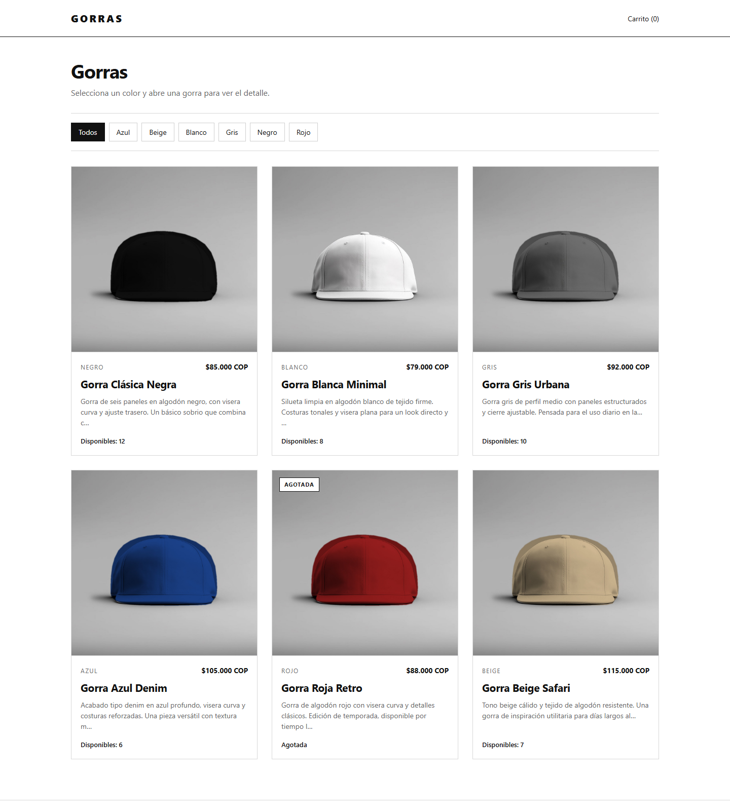

# Gorras — Tienda online MVP

Tienda de gorras full-stack construida en Go como proyecto de portafolio. Incluye catálogo público con filtro por color, carrito en el navegador, pago con Mercado Pago Checkout Pro, webhook de confirmación y un panel de administración protegido para gestionar gorras y revisar órdenes.



## Stack

- **Go** (aplicación monolítica server-side)
- **Gin** para el enrutamiento HTTP
- **GORM** como ORM
- **SQLite puro** mediante `github.com/glebarez/sqlite` (sin CGO)
- **Mercado Pago Go SDK** (`github.com/mercadopago/sdk-go`) para Checkout Pro y consulta de pagos
- **html/template** para las vistas
- **CSS puro** y **JavaScript vanilla** únicamente para el carrito y el modal de producto
- **bcrypt** para el hash de la contraseña del administrador
- Sin Node, sin frameworks JS, sin Tailwind, sin Redis y sin caché de plantillas o consultas

## Funcionalidades

### Tienda pública

- Catálogo de gorras con tarjetas, precio en pesos colombianos y estado de stock.
- Filtro dinámico por color calculado desde los productos publicados.
- Modal de detalle con descripción, color, precio y stock.
- Las gorras agotadas no se pueden agregar al carrito.
- Carrito persistido en `localStorage` usando solo `{ id, quantity }`; los nombres, precios y totales siempre se recalculan en el servidor.
- Página de carrito con edición de cantidades y validación de stock antes de pagar.
- Checkout con Mercado Pago Checkout Pro en COP.
- Páginas de resultado para pago exitoso, pendiente y fallido.

### Pagos y webhook

- La orden se crea en SQLite antes de generar la preferencia de Mercado Pago.
- `external_reference` de la preferencia corresponde al ID interno de la orden.
- El webhook `/webhooks/mercadopago` solo usa el cuerpo para descubrir el ID del pago; el estado real se consulta siempre a la API de Mercado Pago.
- Un pago `approved` marca la orden como `paid`, descuenta stock y suma unidades vendidas dentro de una transacción.
- El procesamiento es idempotente: si el webhook se repite, la orden no se descuenta dos veces.
- Se validan moneda (`COP`) y monto contra el total guardado en la orden.
- Los estados `rejected` y `cancelled` actualizan la orden sin modificar stock.
- Si el descuento de stock falla, la transacción revierte y la orden no queda pagada.

### Panel de administración

- Acceso en `/admin/login`, sin registro público.
- Usuario inicial creado en el primer arranque a partir de `ADMIN_USER` y `ADMIN_PASSWORD`.
- Contraseña almacenada con bcrypt.
- Sesión propia en cookie firmada con HMAC-SHA256, `HttpOnly`, `SameSite=Lax`, expiración de 8 horas y `Secure` automático cuando `APP_BASE_URL` usa HTTPS.
- Protección CSRF en todas las operaciones de escritura del panel.
- Rutas administrativas protegidas por middleware.
- Resumen numérico: gorras publicadas, unidades en stock, unidades vendidas, ingresos de órdenes pagadas y pedidos pagados, con desglose por color.
- CRUD de gorras: crear, editar, publicar u ocultar y eliminar con *soft delete*.
- Subida de imágenes JPG, PNG o WebP de máximo 2 MB, con validación del contenido real y nombre aleatorio.
- Tabla de órdenes con estado, total, fecha y detalle de artículos.

### General

- Código fuente en inglés; interfaz y mensajes de error en español.
- Páginas de error personalizadas para 404 y 500.
- Logs HTTP de Gin.
- `Makefile` con los targets `run` y `build`.

## Estructura

```text
.
├── cmd/
│   └── server/
│       └── main.go              # Punto de entrada
├── internal/
│   ├── config/                  # Variables de entorno y configuración
│   ├── database/                # Conexión SQLite, migraciones y seed
│   ├── models/                  # Cap, Order, OrderItem, AdminUser
│   ├── repository/              # Acceso a datos con GORM
│   ├── services/                # Catálogo, carrito, checkout, pagos y admin
│   ├── payments/                # Cliente del SDK de Mercado Pago
│   ├── handlers/                # Handlers HTTP y renderizado de vistas
│   ├── middleware/              # Sesión, CSRF, recuperación y límites
│   └── router/                  # Cableado de rutas y dependencias
├── web/
│   ├── templates/               # Vistas html/template
│   └── static/
│       ├── css/styles.css
│       ├── js/cart.js
│       └── uploads/             # Imágenes seed y fotos subidas
├── docs/screenshot.png          # Captura de la tienda
├── .env.example
├── Makefile
├── README.md
├── go.mod
└── go.sum
```

## Instalación

Requisitos: **Go 1.27 o superior**. No se necesita CGO ni un servidor de base de datos.

```bash
git clone <URL_DEL_REPOSITORIO>
cd Gstore

# Opcional: crear el archivo de entorno local
cp .env.example .env

go mod download
go run ./cmd/server
```

La aplicación queda disponible en <http://localhost:8080>. En el primer arranque se crea `tienda.db`, se aplican las migraciones y se insertan las seis gorras de demostración junto con el usuario administrador.

También se puede usar el Makefile:

```bash
make run     # go run ./cmd/server
make build   # genera bin/tienda-gorras
```

### Pruebas

```bash
go test ./...
```

Los tests del flujo de checkout y procesamiento de pagos usan SQLite en memoria y un gateway falso. No realizan llamadas reales a Mercado Pago.

## Credenciales demo

```text
URL:      http://localhost:8080/admin/login
Usuario:  admin
Password: admin123
```

Estas credenciales solo se crean si la base de datos todavía no tiene ningún administrador. **Cámbialas antes de publicar el proyecto** ajustando `ADMIN_USER`, `ADMIN_PASSWORD` y `SESSION_SECRET`, y elimina `tienda.db` para volver a sembrar el usuario con los nuevos valores.

La sexta gorra del seed (roja) tiene stock 0 para demostrar el estado **Agotada**.

## Mercado Pago en modo prueba

1. Crea una aplicación en el [panel de desarrolladores de Mercado Pago](https://www.mercadopago.com.co/developers/panel).
2. Copia el **Access Token de prueba** (empieza con `TEST-`) en el archivo `.env`:

   ```env
   MP_ACCESS_TOKEN=TEST-tu-access-token
   ```

3. Configura `APP_BASE_URL` con una URL pública. Mercado Pago necesita poder alcanzar el webhook, por lo que `http://localhost:8080` no sirve para notificaciones reales.
4. Expón el servidor local con un túnel, por ejemplo:

   ```bash
   ngrok http 8080
   # o
   cloudflared tunnel --url http://localhost:8080
   ```

5. Usa la URL pública del túnel:

   ```env
   APP_BASE_URL=https://tu-subdominio.ngrok-free.app
   ```

   Si no defines `MP_NOTIFICATION_URL`, `MP_SUCCESS_URL`, `MP_PENDING_URL` o `MP_FAILURE_URL`, se derivan automáticamente de `APP_BASE_URL`:

   ```text
   https://tu-subdominio.ngrok-free.app/webhooks/mercadopago
   https://tu-subdominio.ngrok-free.app/pago/exitoso
   https://tu-subdominio.ngrok-free.app/pago/pendiente
   https://tu-subdominio.ngrok-free.app/pago/fallido
   ```

6. Reinicia la aplicación y completa una compra con una [tarjeta de prueba](https://www.mercadopago.com.co/developers/es/docs/checkout-pro/additional-content/your-integrations/test/cards) de Mercado Pago.
7. Verifica en el panel de administración que la orden pasa a `paid`, que el stock baja y que las unidades vendidas aumentan.

> **Limitación del entorno de entrega:** el proyecto no incluye credenciales reales de Mercado Pago. Sin `MP_ACCESS_TOKEN`, el endpoint `POST /checkout` responde `503` con un mensaje claro y el resto de la tienda sigue funcionando. El flujo de pago está cubierto por tests con un gateway falso; la integración contra la API real requiere credenciales de prueba propias.

### Probar el webhook manualmente

Con el servidor en ejecución y `MP_ACCESS_TOKEN` configurado:

```bash
curl -X POST "http://localhost:8080/webhooks/mercadopago?type=payment&data.id=ID_DEL_PAGO"
```

El webhook ignora notificaciones que no sean de tipo `payment`, responde `400` si falta el ID y consulta el pago real antes de modificar la orden.

## Variables de entorno

| Variable | Valor por defecto | Descripción |
|---|---|---|
| `APP_BASE_URL` | `http://localhost:8080` | URL pública base; se usa para las URLs de retorno y el webhook. |
| `PORT` | `8080` | Puerto HTTP local. |
| `DB_PATH` | `tienda.db` | Ruta del archivo SQLite. |
| `SESSION_SECRET` | Secreto efímero aleatorio | Clave para firmar la cookie de administrador. En producción debe ser un valor largo y estable. |
| `ADMIN_USER` | `admin` | Usuario creado en el primer arranque si no existe ningún administrador. |
| `ADMIN_PASSWORD` | `admin123` | Contraseña inicial del administrador; se hashea con bcrypt. |
| `MP_ACCESS_TOKEN` | vacío | Access Token de Mercado Pago. Sin él, el checkout queda deshabilitado con un error explícito. |
| `MP_NOTIFICATION_URL` | `APP_BASE_URL/webhooks/mercadopago` | URL pública que Mercado Pago usará para notificar pagos. |
| `MP_SUCCESS_URL` | `APP_BASE_URL/pago/exitoso` | Retorno después de un pago aprobado. |
| `MP_PENDING_URL` | `APP_BASE_URL/pago/pendiente` | Retorno después de un pago pendiente. |
| `MP_FAILURE_URL` | `APP_BASE_URL/pago/fallido` | Retorno después de un pago rechazado o fallido. |

Las variables se leen desde `.env` si el archivo existe; de lo contrario se usan los valores por defecto. `.env` y las bases de datos locales están excluidos en `.gitignore`.

## Nota de portafolio

Este proyecto fue construido como una demostración full-stack deliberadamente acotada: un solo binario Go, SQLite y vistas renderizadas en el servidor, sin capas innecesarias. El objetivo es mostrar el flujo completo de una tienda real —catálogo, carrito, creación de orden, pago externo, webhook idempotente y administración— con decisiones explícitas sobre validación en servidor, seguridad de sesiones, manejo de stock y separación por paquetes.

Las seis fotos del catálogo son variantes locales de un mockup de gorra con licencia CC0, recoloreadas para representar los colores del seed. No se incluyen credenciales de Mercado Pago ni datos de producción. Para una puesta en marcha real habría que cambiar las credenciales demo, usar HTTPS, definir un `SESSION_SECRET` persistente, configurar el webhook público y añadir observabilidad y respaldos de la base de datos.
